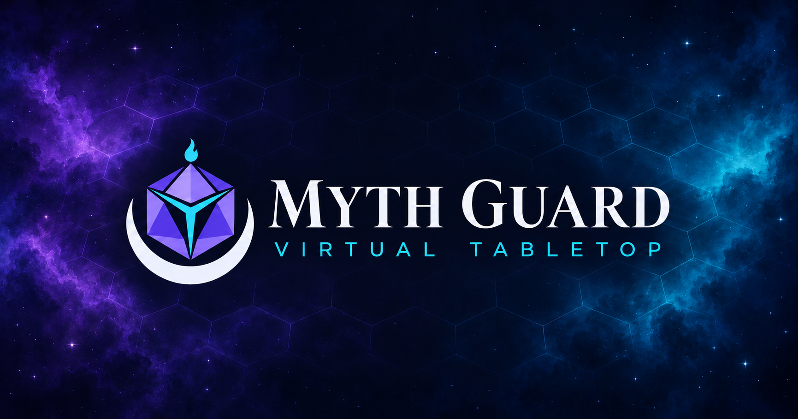

<p align="center"></p>

# Myth Guard

A local virtual tabletop for Dungeons & Dragons. The Game Master runs it on one
computer; players join from their phones, tablets or a shared screen over the
same Wi-Fi. No accounts, no internet, nothing leaves your home.

## Quick start

1. Double-click **`START.bat`**. The first run installs what it needs; after an
   update it spends a few seconds preparing a fast build.
2. Open **http://localhost:5173** on the GM computer.
3. Click **Table → Invite players** (or the pill in the header). Players scan the
   **QR code** with their phone camera, enter a name, and take their seat. A phone
   with no camera handy can open the address and type the 8-character **table
   code** instead (shown as `ABCD-EFGH`).
4. Choose who may join: **Open** (anyone with the QR code or table code gets in),
   **Ask first** (you press *Admit* for each new device) or **Locked** (no new
   devices; players already seated can reconnect). **Kick** removes a device;
   **New invite** makes every old QR code and table code stop working.

If Windows asks, allow **Node.js** on **Private networks**. If players still
cannot connect, run **`ENABLE-LAN.ps1`** once as administrator, and make sure
everyone is on the same Wi-Fi (guest networks often isolate devices).

`START-DEV.bat` runs the development server with live reload, for changing the app.
Both launchers reuse a server that is already running.

---

## For the Game Master

The screen has five parts: the **header** (scene, table status, import, save),
the **tool rail** on the left, the **map** in the middle, a **sidebar** on the
right with a tab for each job, and a **status bar** with hints.

| Tab | What it does |
|---|---|
| **Scenes** | Save and reopen maps with their tokens, fog and combat. Warns before you lose unsaved work. |
| **Tokens** | Heroes, creatures and objects. Reveal/hide, edit, duplicate, and keep favourites in a library. |
| **Combat** | Roll or enter initiative, step through turns, track hit points with one-click damage and healing. |
| **Table** | Who has joined (with connection quality), and which hero belongs to which player. |
| **Quests / NPCs** | Private, searchable notebooks. An NPC can be placed on the map as a hidden token. |
| **Sheets** | Character-sheet PDFs, docked beside the map, switched with the number keys. |
| **Handouts** | Preview privately, then reveal an image to every player. |
| **Spells / Markers** | Measured circles, squares and cones in damage-type colours; points of interest. |
| **Sound** | Share your computer's music or ambience with chosen players (audio only). |
| **Settings** | Grid, scale in feet, fog, and the frame that decides what players see. |

Tips:
* **Tool options float over the map** where your hand already is — fog brush size,
  spell size, marker colour. Fog strokes are continuous; fast drags leave no gaps.
* While combat runs, the **turn chip** at the top of the map has *Next turn*, so
  you rarely need the Combat tab open.
* Hidden tokens appear faded on your map, so you always know what players cannot see.
* **Ctrl+S** saves, **?** lists every shortcut.
* Creatures show players a *condition* (Healthy → Wounded → Badly wounded → Almost
  dead → Down); heroes show exact hit points.

### Keyboard

`V` select · `H` pan · `M` marker · `F` hide with fog · `E` reveal · `C`/`R`/`K` circle,
square, cone · `G` grid · `P` player frame · `S` sheets (`1`–`9`, `←` `→`, `Esc`) ·
`Delete` remove selection · `Ctrl+S` save · `?` help.

---

## For players

Scan the Game Master's QR code (or open their address and type the table code),
enter a name, and you're in. In *Ask first* mode you wait until the Game Master
lets you in. A phone remembers the table, so reloading or waking it needs no code;
private browsing or cleared site data counts as a new device.

* **Pan** with one finger, **pinch** to zoom, or use the buttons. You can look
  around inside the frame the GM chose, never beyond it.
* **Drag your hero** to move it (when the GM has assigned one and allows movement).
  The 🎯 button centres the map on your hero.
* The **turn order** is at the top. When it is your turn, you get a banner and a
  buzz on phones that support it.
* The **tool rail** on the right edge has three buttons:
  * **Ping**: tap it, then tap the map. A glowing ripple with your name shows
    everyone, including the GM, where to look. One tap, one ping.
  * **Measure**: drag on the map to see the distance in feet and squares. It
    starts on a hero if you touch one, and it stays on your phone only.
  * **End turn**: lights up when it is your hero's turn. Tap it and the GM's
    turn order moves on. It is greyed out the rest of the time.
* **Handouts** appear full screen — tap *Hide for now* to peek at the map, and
  *Show the handout* to bring it back.
* If the GM shares sound, tap the **"Tap to hear the music"** pill once (browsers
  require a touch before they will play sound).
* The pill at the top shows your connection. Dropped connections rejoin on their own.

---

## How the networking works

* **Joining is by invitation.** The QR code holds a secret in the
  part of the link after the `#`, which phones never send over the network. The
  typed table code is a shorter alternative that works only while the Invite
  screen is open (and ten minutes after). Each phone then gets its own key, and
  every later connection proves it holds that key. Wrong codes are rate-limited;
  too many lock the table.
* **You decide who sits.** *Open*, *Ask first* and *Locked* (above), plus **Kick**
  and **New invite**. The device list shows each device, its connection quality
  and whether it is admitted, waiting or offline. Press `Ctrl+Shift+D` on either
  page for a small network read-out.
* **Secrets never leave the GM computer.** The server filters what players may
  see (hidden or fogged tokens, hidden markers, private notes, exact creature
  hit points) *before* sending.
* **Only changes are sent, and images travel once.** Players get small patches
  after the first snapshot; maps, token art and handouts are shared by content
  name and cached by the browser. Late joiners and reconnecting phones are served
  the current scene by the server, even if the GM window is closed for a while.
* **Sound uses WebRTC, with an automatic fallback.** Shared sound goes to each
  phone as a direct low-latency stream and switches to a hardened WebSocket path
  by itself if that fails (some routers block it). Sharing PC sound needs the GM
  page opened from `http://localhost:5173`.
* **Self-healing connections.** Heartbeats detect silent Wi-Fi drops; reconnects
  back off with jitter and resume from where the phone left off.

**What is not protected.** The app runs on plain HTTP over your home network, so
it does not encrypt anything itself: Wi-Fi encryption (WPA2/WPA3 with a password
only your table knows) is your protection from outsiders. The invite stops
strangers *joining*; it does not hide traffic from someone who has already joined
or who can capture your Wi-Fi traffic and also knows the invite. Fog of war is an
overlay: the whole map image is sent to players, so a player who opens browser
developer tools can look at the map under the fog. Use **New invite** and **Kick**
after a guest leaves. The server keeps device keys and its secret in
`.realm-data/`; do not share that folder.

Design and test notes: [`docs/network-design.md`](docs/network-design.md);
checks that need real phones: [`docs/real-device-checklist.md`](docs/real-device-checklist.md).

Saved scenes, libraries, handouts and PDFs stay in the GM's browser storage
(keep using the same address, `localhost:5173`).

---

## Project layout

```
START.bat / START-DEV.bat   launchers          ENABLE-LAN.ps1   firewall helper
server/
  sessionSync.js    table hub: scene → filtered view → patches, ownership, roster
  assetStore.js     content-addressed image store and its HTTP endpoints
  realmMiddleware.js  cookie, status, join info (shared by dev and production)
  serve.js          production server: static files + hub
  audioRelay.js     sound broadcast relay
src/
  broadcast.js          GM and player links          sessionTransport.js  resilient socket
  syncPatch.js          diff / apply patches         playerView.js        what players may see
  assetPublisher.js     image upload and shrinking   ownership.js         who may move what
  App.jsx, gm/          GM screen                    PlayerApp.jsx, player/  player screen
  canvas/               Konva map (shared.jsx = fog, grid, tokens)
  ui.jsx, icons.js      UI kit and icons             styles/              design system
  audio/                capture, ADPCM codec, playback
test/                   npm test  (network, patches, privacy, audio, combat)
```

`npm test` runs the automated tests. `npm run build` makes the production build,
`npm run icons` regenerates the icon set from Lucide.
